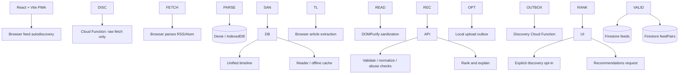

# PS-003 Small Web Reader — Reviewed Final Implementation Plan (v3: Feed Deduplication and Seed Audit Edge Cases)

**Purpose:** This is the reviewed implementation blueprint for the coding agent. It consolidates the PS-003 requirements and the team's decisions, and resolves the transaction-size, HTTP App Check, seeded-data, per-post viewed-state, and feed-deduplication/seed-audit decisions. This revision adds conservative same-feed detection, malformed-feed classification, false-positive safeguards, a fast seed audit for the bonus quest, and explicit edge-case tests. Follow this document as the source of truth unless a requirement is explicitly marked as optional.

**Project:** Small Web Reader — Anonymous Discovery for Independent Blogs  
**Chosen stack:** Vite + React + TypeScript, Tailwind CSS + shadcn/ui, Firebase Hosting, Firebase Cloud Functions, Cloud Firestore, Dexie/IndexedDB, and `vite-plugin-pwa`.

\---

## 0\. Instructions for the coding agent

1. Read this plan fully before changing files.
2. Inspect the existing repository first. Preserve useful existing code and conventions; do not replace working code blindly.
3. Implement in the milestones below, keeping the app runnable after each milestone.
4. Do not build fake security, fake offline support, or mock recommendation results while claiming the real features work.
5. Keep all feed parsing, article extraction, HTML sanitization, and content caching in the browser.
6. The server fetch route may fetch and return raw upstream content only. It must not parse, extract, store, or cache feed/article content.
7. Personalized discovery must be off until the user explicitly opts in. Sending a batch that updates aggregate counts requires an additional explicit contribution action. Do not create accounts, permanent reader IDs, or server-side reader profiles.
8. Protect all aggregate writes behind trusted backend functions. Never expose Firestore write credentials or permit unauthenticated clients to write aggregate counters directly.
9. Use Zod or equivalent schema validation at API boundaries. Validate again on the server even if the client validates.
10. Use tests for recommendation math, idempotent retries, URL normalization, rate limiting, feed parsing, sanitization, and offline behavior.
11. Do not claim a feature is complete until its acceptance criteria pass.
12. If an implementation decision conflicts with the PS-003 requirements, follow the problem statement and document the trade-off rather than silently changing the requirement.
13. Before writing application code, confirm the team can deploy Firebase Cloud Functions: production deployment requires the Firebase Blaze pay-as-you-go plan. If the team cannot attach billing, stop and choose a replacement backend/hosting stack before implementation; do not build most of the app around an undeployable backend.
14. Pin the Functions runtime to Node.js 22 and commit a lockfile. Test locally with the Firebase Emulator Suite before deployment.

\---

## 1\. Product goal and scope

Build a web-based, offline-first RSS/Atom reader that lets users:

* Follow independent blogs through their RSS/Atom feeds.
* See posts from all followed feeds in one chronological timeline.
* Filter the timeline by feed and mark posts read/unread.
* Read clean, extracted full-text articles.
* Continue reading previously cached posts/articles while offline.
* Discover blogs through anonymous recommendations based on aggregate popularity and co-subscription patterns.
* Use the app without accounts, tracking profiles, or persistent server-side reader IDs.

### Core discovery principle

If feeds A and B often appear together in accepted anonymous subscription submissions, B may be useful to someone who follows A.

This is not a YouTube-style engagement recommender. The required signals are feed popularity and co-subscription counts. Do not collect viewing/reading duration, article-level behavior, or personal profiles for recommendation ranking.

### Out of scope for the first version

Do not prioritize these until all required features work:

* AI/LLM-based recommendations.
* Accounts, sign-in, or cloud-synced personal subscriptions.
* Persistent server-side reader identities.
* Bank-like/third-party profile enrichment or reading-history tracking.
* Complex collaborative-filtering models.
* Graph visualization, folders/tags, or OPML import/export unless time remains.

\---

## 2\. Terminology — use consistently in code and UI

|Term|Meaning|
|-|-|
|**Blog/site**|A website that publishes articles.|
|**Feed**|The RSS or Atom URL from which posts are published. This is the primary unit of subscriptions and discovery.|
|**Post/entry**|One item in a feed, usually linking to an article page.|
|**Article URL**|The original webpage for an individual post.|
|**Subscription**|A user's local choice to follow a feed. In the UI, “Follow blog” and “Subscribe to feed” may describe the same action.|
|**Subscription list**|The feeds the user currently follows. Stored locally; shared only with opt-in.|
|**Anonymous batch**|A one-time submission of the selected eligible feed URLs (up to 20) for aggregate discovery, without an account or persistent reader ID.|
|**Popularity count**|Number of accepted anonymous batch contributions containing a feed. It is an aggregate contribution count, **not a verified unique-person count**.|
|**Co-subscription / feed pair**|Two distinct feeds appearing together in an accepted batch.|
|**Pair hit**|One accepted batch contribution to a pair's aggregate count. It must not be labelled as a unique reader.|
|**Personalized-discovery opt-in**|The user's explicit permission to send eligible feed URLs transiently for personalized ranking and to access the separate contribution action.|
|**Local discovery consent state**|Browser-local preference and submission metadata. It is not a server-side user identity.|

Example:

* Blog/site: `https://example.com`
* Feed: `https://example.com/feed.xml`
* Post: one entry inside the feed
* Article URL: the webpage linked by that post

The recommendation engine ranks feeds/blog sources, not individual articles.

\---

## 3\. Requirements that must be met

### Reader

* Unified chronological timeline.
* Subscription list and add/unfollow actions.
* Reading view.
* Discover page.
* RSS and Atom support.
* Feed autodiscovery via `<link rel="alternate">` and common paths such as `/feed`, `/feed.xml`, `/rss.xml`, and `/atom.xml`.
* Read/unread state and filtering by feed.
* Graceful handling of dead feeds, malformed XML, empty feeds, and slow servers.
* Full-text article extraction in the browser.
* Sanitize extracted HTML before rendering.
* Summary + original link fallback when extraction fails.
* Offline cache for posts, extracted article content, and reading state.

### Server fetch route

* Accept a URL and return the raw upstream response to work around browser CORS restrictions.
* Must not parse or store feed/article content.
* Must defend against SSRF, private/local destinations, unsafe redirects, excessive response size, and slow upstream servers.

### Anonymous discovery

* No accounts or persistent reader IDs.
* Sending subscription URLs to personalized discovery is off by default and requires explicit opt-in.
* Updating aggregate popularity/pair data requires a separate explicit contribution action; opening Discover or asking for recommendations must never increment counters.
* Database-backed API for batch submission, recommendations for a supplied feed set, and popular feeds.
* Ranking combines popularity and co-subscription.
* Never recommend feeds already followed.
* Normalize URLs and deduplicate entries.
* Accept only valid HTTP(S) URLs for discovery submissions.
* Cap request/body/batch size and reject private/local IP ranges. The first implementation must cap each write-heavy submission batch at 20 selected feeds so all aggregate changes plus the receipt can fit safely in one Firestore transaction.
* Add backend-enforced rate limits and verify App Check tokens explicitly for the ordinary HTTP routes. Signed single-use tokens are optional stretch work, not a prerequisite.
* If IP-derived data is used, store only a short-lived HMAC-derived rate-limit key with expiry; never store raw IPs.
* Explain the threat model and privacy limitations in the README.

### Delivery

* Deployed web application.
* Public GitHub repository.
* Seed list of 10–15 blogs and pre-populated discovery aggregates.
* 2–3 minute demo: add feeds, read an extracted article offline, and subscribe to a recommendation.
* Short presentation.
* README with architecture, setup, privacy/threat model, demo instructions, and edge cases.
* Two hidden test sites will be used; do not hardcode behavior only for seed sites.

\---

## 4\. Final technology decisions

|Layer|Decision|Notes|
|-|-|-|
|Frontend|**Vite + React + TypeScript**|Single-page web app and typed contracts.|
|UI|**Tailwind CSS + shadcn/ui**|Cards, buttons, menus, dialogs, badges, skeletons, alerts, toasts.|
|PWA|**`vite-plugin-pwa`**|App-shell caching and installability. Background sync is progressive enhancement only.|
|Local DB|**Dexie over IndexedDB**|Subscriptions, posts (including per-post `isViewed`), article cache, local sharing state, outbox.|
|Feed parsing|Browser-side RSS/Atom parser|`fast-xml-parser` or a suitable RSS/Atom parser. Normalize parser output into one internal type.|
|Article extraction|Mozilla Readability or equivalent|Runs in the browser on fetched article HTML.|
|HTML safety|**DOMPurify**|Sanitize extracted HTML before rendering.|
|Backend|**Firebase Cloud Functions (2nd gen, Node.js 22)**|Raw fetch route and discovery API. HTTP App Check verification must be implemented in the HTTP handler; do not assume the console toggle automatically protects Express/onRequest routes.|
|Database|**Cloud Firestore**|Feed aggregates, pair aggregates, and short-lived abuse/idempotency records.|
|Hosting|**Firebase Hosting**|Static Vite build; rewrite API paths to Cloud Functions.|
|Validation|**Zod**|Validate all request bodies and query parameters server-side.|
|Testing|**Vitest + React Testing Library + Playwright**|Unit/component and end-to-end tests.|

**Deployment gate:** Functions deployment requires the Firebase Blaze pay-as-you-go plan. Confirm billing access before coding the backend, set budget alerts, and review quotas. Budget alerts are notifications, not hard spending caps. Use the Firebase Emulator Suite for local development/tests. Keep Firestore access server-controlled and use deny-by-default client security rules.

\---

## 4.1. Constraints that must not be deferred

* **Firebase billing:** Cloud Functions production deployment requires the Blaze plan. Verify billing access before committing to the backend.
* **Firestore transaction size:** a submission contains at most 20 selected feed URLs. This cap is separate from how many feeds a user can follow locally. If more than 20 feeds are selected, require the user to choose a subset; never silently truncate.
* **HTTP App Check:** custom HTTP endpoints must explicitly verify the token; do not assume callable-function enforcement applies to Express/onRequest routes.
* **Fetch proxy:** this is not a generic open proxy. Require SSRF defenses, destination pinning, response limits, redirects limits, and a specific fetch rate limit.
* **Seed/live integrity:** keep demo counts and live contribution counts in separate fields and show them separately.
* **No premature infrastructure:** do not add Cloud Tasks, a queue service, a second database, or a separate microservice unless a measured requirement demands it. The v1 should remain one frontend, one Functions backend, and one Firestore database.

\---

## 5\. Architecture and data boundaries

### Browser/client owns

* Site-to-feed autodiscovery.
* Fetching raw XML/HTML via the fetch route.
* A local URL-sharing safety check that warns and excludes credential-bearing or secret-like feed URLs from anonymous contributions.
* RSS/Atom parsing and post normalization.
* Article extraction.
* HTML sanitization.
* Local subscriptions, posts, cached articles, and each post's `isViewed` state.
* Personalized-discovery opt-in, local consent state, and one-time contribution outbox.
* Rendering timeline, reader, Discover, and explanations.

### Fetch route owns

* Validating the target URL and destination.
* Fetching upstream raw content.
* Returning response body/status and safe content metadata.
* SSRF defenses, timeouts, and response-size limits.
* **It does not parse, extract, store, or cache feed/article content.**

### Discovery API owns

* Validating and normalizing submitted feed URLs.
* Rate limiting and abuse checks.
* Resolving canonical feed records.
* Updating popularity and pair aggregates safely.
* Ranking candidates and serving popular feeds.
* Returning explanations based on real aggregate evidence.

### Firestore stores

* Canonical feed metadata and aggregate popularity counts.
* Canonical feed-pair counts.
* Short-lived rate-limit/token/idempotency records if needed.
* Seed/demo data.

### Firestore must not store

* User accounts or persistent reader IDs.
* Per-reader subscription profiles.
* Raw subscription batches as long-term histories.
* Feed XML, article HTML, extracted article content, or reading history.
* Raw IP addresses.

### Architecture diagram



\---

## 6\. Repository structure

Use this as a target structure, adapting to an existing repository rather than rewriting blindly.

```text
small-web-reader/
├── src/
│   ├── app/
│   │   ├── App.tsx
│   │   └── router.tsx
│   ├── components/
│   │   ├── layout/
│   │   ├── feed/
│   │   ├── reader/
│   │   └── discover/
│   ├── pages/
│   │   ├── HomePage.tsx
│   │   ├── DiscoverPage.tsx
│   │   └── SettingsPage.tsx
│   ├── features/
│   │   ├── subscriptions/
│   │   ├── feed-parser/
│   │   ├── article-reader/
│   │   ├── offline-cache/
│   │   └── discovery/
│   ├── lib/
│   │   ├── firebase.ts
│   │   ├── db.ts
│   │   └── api.ts
│   ├── types/
│   └── tests/
├── functions/
│   └── src/
│       ├── index.ts
│       ├── routes/
│       │   ├── fetch.ts
│       │   ├── submit.ts
│       │   ├── recommendations.ts
│       │   └── popular.ts
│       ├── middleware/
│       │   ├── rateLimit.ts
│       │   └── validateRequest.ts
│       ├── discovery/
│       │   ├── normalizeUrl.ts
│       │   ├── processBatch.ts
│       │   ├── recommend.ts
│       │   └── rank.ts
│       └── tests/
├── public/
├── firebase.json
├── firestore.rules
├── firestore.indexes.json
├── package.json
└── README.md
```

\---

## 7\. Local data model — Dexie / IndexedDB

Create a Dexie database with versioned schema migrations. At minimum, use tables equivalent to:

### `subscriptions`

Suggested fields:

* `feedId` or local stable key
* `feedUrl` (normalized)
* `siteUrl` if known
* `title`
* `isSubscribed`
* `addedAt`
* `lastFetchedAt`
* `lastFetchStatus`
* `lastError` (safe, user-facing status only)

The user's subscriptions are local and are not synced to the server as a profile.

### `posts`

Suggested fields:

* `postId` (stable local key, derived from feed identity + canonical post URL or stable GUID)
* `feedId` (the feed this post belongs to; required)
* `title`
* `articleUrl`
* `publishedAt`
* `summary`
* `isViewed: boolean` (per-post, per-local-reader state; default `false` for newly discovered posts)
* `cachedAt`

`isViewed` is local reading state, not a global view count and not a discovery/pairing signal. Set it to `true` when the reader opens the post in the app's reader view; allow the user to mark a post unread, which sets it back to `false`. Persist the value in Dexie so it survives refreshes and offline use. When an already-known post is refreshed from its feed, preserve its existing `isViewed` value rather than resetting it.

**Timeline ordering:** place posts with `isViewed === false` before posts with `isViewed === true`. Within each group, sort by `publishedAt` descending (newest first), with a deterministic fallback for missing dates. Feed filtering must not change this ordering rule. If a user explicitly chooses a chronological-only sort, that can be an optional UI control; the default must prioritize unviewed posts.

Avoid treating post URLs as feed URLs. Handle missing GUIDs and duplicate entries gracefully.

### `articles`

Suggested fields:

* `postId`
* `sanitizedHtml`
* `plainText` (optional)
* `extractedAt`
* `source` (`extracted` or `summary-fallback`)

Only store sanitized article HTML for rendering. Never inject unsanitized upstream HTML.

### `sharingState`

Local-only fields:

* `personalizedDiscoveryEnabled` (default `false`; authorizes stateless subscription-set requests for personalized recommendations)
* `lastSubmittedSnapshotHash` or equivalent local snapshot marker
* `lastSuccessfulSubmissionAt`
* `updatedAt`

This is local convenience state, not a persistent reader ID. Do not send this local fingerprint to the server as a stable identity.

### `outbox`

* Random `requestId` for request idempotency.
* A bounded anonymous batch payload.
* Creation time and retry metadata.
* Status (`pending`, `sent`, `failed`).
* Last error category.

Use the same request ID for retries of the same queued request. Do not reuse it as a long-lived identity.

**Do not add a per-feed `hasBeenShared` flag as the only deduplication strategy.** A feed-level flag cannot deduplicate pair contributions when the subscription set changes.

\---

## 8\. Firestore data model

Use a deterministic server-generated document ID for each normalized feed URL, e.g. `feedId = hex(SHA-256(normalizedFeedUrl))`. Never trust a client-supplied `feedId` as canonical; recompute it on the server. Use the sorted pair of those feed IDs to make a stable `pairId`.

### `feeds/{feedId}`

```ts
type FeedAggregate = {
  normalizedUrl: string;
  seededPopularityCount: number; // synthetic/demo data only
  livePopularityCount: number;   // accepted anonymous batch contributions only
  title?: string;
  siteUrl?: string;
  seeded?: boolean;
};
```

Never combine seeded/demo values and live values into one displayed count. Ranking may use a combined score, but API responses and UI labels must retain the distinction. `livePopularityCount` means accepted anonymous batch contributions, not verified unique people.

### `feedPairs/{pairId}`

```ts
type FeedPairAggregate = {
  feedA: string; // canonical sorted feed ID
  feedB: string; // canonical sorted feed ID
  seededCoSubscriptionCount: number; // synthetic/demo data only
  liveCoSubscriptionCount: number;   // accepted anonymous batch contributions only
};
```

Always sort the pair's feed IDs before creating `pairId`, so `(A, B)` and `(B, A)` refer to one record. Ranking uses the sum of seeded and live signals, while explanations must say when a result is supported by demo data, live data, or both.

### Short-lived control collections

Only if needed:

* `rateLimits`: HMAC-derived short-lived rate-limit key, window, counter, expiry.
* `submissionTokens`: token hash, expiry, consumed state (optional stretch feature only).
* `submissionReceipts`: random request ID, result/processed state, expiry.

These records must expire and must not become reader profiles. Never store raw IPs. If IP-derived data is used for rate limiting, use trusted platform-provided client-IP metadata (never an arbitrary caller-supplied forwarding header), derive a short-lived HMAC key, and expire it quickly. If trustworthy client IP metadata is unavailable, document the limitation and use another abuse-control strategy rather than trusting spoofable input.

\---

## 9\. Final decision: anonymous batch and counting semantics

The PS-003 wording requires submitting a subscription list as a **single anonymous batch**. Use that contract for the first version. Each accepted batch contains up to 20 feed URLs; when a reader follows more than 20, ask them to select the subset to include. Do not silently truncate the list or switch to an API that submits only incremental pairs.

### Chosen behavior

1. Personalized discovery is off by default.
2. Enabling personalized discovery permits eligible selected feed URLs to be sent with recommendation requests. It does not update aggregate counters.
3. To contribute, personalized discovery must be enabled; the user must separately click **Contribute selected feeds**, review the exact list, and confirm. The client then queues one anonymous batch containing up to 20 eligible feed URLs. If the user follows more than 20 eligible feeds, let them select up to 20; never silently truncate the list, and disclose exactly which feeds will be submitted. Disabling personalized discovery stops all future subscription-list transmissions and cancels queued, unsent contributions.
4. The client does not automatically resubmit an unchanged list merely because the app reloads or reconnects.
5. A successful submission is acknowledged by the server. Only then does the client update its local last-submitted marker.
6. If the server processed the request but the response was lost, retry with the same random request ID. The server returns the prior result rather than counting it again.
7. If the selected subscription set later changes and the user explicitly shares it again, that is a **new accepted batch contribution**. Existing pairs may appear again and increment again.
8. Therefore, popularity and pair counts mean **accepted anonymous batch contributions**, not unique people and not unique permanent subscription sets.

This policy is honest, implementable, and matches the required single-batch submission shape while respecting the transaction cap. The user chooses the exact eligible subset when more than 20 feeds are followed. It does not claim to deduplicate one human across multiple devices or across changed snapshots. Do not describe aggregate counts as unique users.

### Why not use only a local `hasBeenShared` flag?

A per-feed flag cannot track which pairs were already counted. Example: `\\\\\\\[A, B, C]` was submitted; later the list becomes `\\\\\\\[A, B, C, D]`. Submitting the full list again contributes A–B, A–C, and B–C again as well as the new D pairs. Under the chosen policy, this is a new batch contribution, so those increments are expected and must be documented.

### Request idempotency

* Every outbox request gets a cryptographically random request ID.
* Retries of that same queued request reuse the same ID.
* The server must atomically ensure the same request ID cannot be counted twice.
* A receipt must be committed atomically with the aggregate updates; it must not be marked complete if any counter update fails.
* Keep the receipt at least as long as the client retry window (e.g. 7 days) and expire it afterwards. Do not retry an expired outbox item under the old ID; require a new explicit contribution action.
* A new explicit submission gets a new request ID.

A request ID only prevents retry duplication; it does not prove unique-person identity.

\---

## 10\. Anonymous submission and outbox flow

### Opt-in UI

* Personalized discovery is off by default.
* Clearly distinguish two actions: (a) enabling personalized discovery, which sends eligible selected feed URLs transiently with ranking requests, and (b) clicking **Contribute selected feeds**, which additionally updates aggregate counts.
* Do not send subscription URLs or a context-feed URL to the recommendations endpoint before the user has explicitly opted in. With opt-in disabled, use global popular data and filter already-followed feeds locally.
* Before any outbound discovery request, omit credential-bearing URLs and URLs with suspicious secret-like query keys. Explain exclusions to the user; never silently strip query parameters or log raw URLs.
* Provide a way to disable future sharing. Explain that already aggregated counts cannot reliably be attributed to or removed for one person because no persistent identity is retained.

### Outbox behavior

1. User clicks **Contribute selected feeds**, reviews the exact selected URLs, and confirms this one-time aggregate contribution.
2. Create one snapshot of the selected subscribed feed URLs (at most 20).
3. Normalize and deduplicate locally for a better user experience; server repeats all validation.
4. Create a random request ID and store the queued request in IndexedDB.
5. If online, send it to the backend. If offline, keep it pending.
6. On server success, mark the request sent and update local last-submitted snapshot metadata.
7. If a response is lost, retry the same request ID.
8. On app startup/foreground and `online` event, retry pending contribution requests only while personalized discovery remains enabled and the request is still eligible.
9. Do not promise background uploads when the app is closed; service-worker/background sync is progressive enhancement only.
10. Do not automatically resubmit the unchanged list just because connectivity returned.

If the user cancels a pending contribution before it is sent, remove it from the outbox. Turning personalized discovery off must immediately stop sending subscription lists/context-feed URLs to the recommendations endpoint and cancel queued, unsent contribution batches. It does not retroactively erase previously accepted aggregate contributions.

\---

## 11\. Discovery algorithm

### 11.1 Batch processing

For a batch containing unique feeds `A, B, C, D`, generate all unique unordered pairs:

* A–B
* A–C
* A–D
* B–C
* B–D
* C–D

For `n` unique feeds, pair count is `n × (n − 1) / 2`. Deduplicate URLs before pair generation and cap batch size because pair growth is quadratic.

Conceptual algorithm:

```text
processBatch(request):
    validate schema and request size
    enforce App Check / abuse controls / rate limit
    verify requestId has not already been processed

    urls = normalizeAndDeduplicate(request.subscriptions)
    validate every URL and reject prohibited destinations
    ids = resolveCanonicalFeedIds(urls)

    atomically:
        read the receipt and every target feed/pair aggregate document before any writes
        if requestId already has a completed receipt:
            return stored prior result

        increment livePopularityCount once for each feed in ids
        generate each unique unordered pair from ids
        increment liveCoSubscriptionCount once for each generated pair
        store successful idempotency receipt

    return acknowledgement
```

The transaction/write design must respect Firestore transaction and batch limits. If one atomic operation cannot safely fit the allowed batch, do not split it into uncoordinated chunks and report success prematurely. Either lower the batch cap or implement explicit resumable processing with an idempotent operation ledger and recovery tests.

Transaction callbacks may be retried; do not perform external side effects inside them. Test simultaneous submissions and partial failures.

### 11.2 Recommendation query for entire subscription list

Input: current subscribed feed URLs/IDs.

For a user set `S`, candidate `c` receives the starter score:

```text
pairTotal(a, b) = seededCoSubscriptionCount(a, b) + liveCoSubscriptionCount(a, b)
popularityTotal(c) = seededPopularityCount(c) + livePopularityCount(c)
coScore(c) = sum(pairTotal(feed, c) for each feed in S)
score(c) = coScore(c) + lambda \\\\\\\* popularityTotal(c)
```

Where `lambda` is a small tunable popularity weight. The exact weight is an implementation choice, not prescribed by PS-003.

Steps:

1. Normalize/resolve the supplied subscription set (cap the request at 100 subscriptions).
2. Find candidate feeds linked to any feed in the set. Query `feedPairs` in chunks because Firestore `in` queries have operand limits: query `feedA` and `feedB` separately for each chunk, then union/deduplicate pair documents by `pairId`. For a current-feed request, query both orientations (`feedA == A` and `feedB == A`).
3. Exclude every feed already in the set.
4. Sum pair counts between candidate and followed feeds.
5. Add popularity as a secondary signal or weighted term.
6. Sort by score descending with deterministic tie-breaking.
7. Return the top 10 candidates (configurable).
8. Include source-aware explanations, e.g. “This feed is linked to two of your subscriptions in the demo dataset” or “Often submitted alongside this feed in live anonymous batches.”
9. Do not invent explanation evidence or expose a misleading unique-reader count.

If there is insufficient co-subscription data, return a clearly labelled popular-feeds fallback rather than an empty page, while still excluding already-followed feeds.

### 11.3 “Blogs like this” for the currently read feed

**Pairing is performed at the feed level, never at the post level.** A post belongs to a `feedId`, and recommendations use that post's parent feed as the input. `isViewed` is strictly local post-reading state; it must not increment co-subscription counts, affect pair records, or be interpreted as a view count.

When reading a post from feed A:

1. Resolve the post's parent `feedId` (feed A).
2. Query pair records containing feed A.
3. Use the other feed in each pair as a candidate.
4. Exclude all feeds the reader already follows.
5. Sort by combined seed + live pair score descending.
6. Show the top five.
7. Explain the source honestly, e.g. “Often co-listed in demo data” or “Also submitted alongside this feed in anonymous batches.”
8. Never label a score as a count of unique people. If showing counts, split demo/sample pair hits from live accepted anonymous contributions.

### 11.4 Popular feeds endpoint

Return feeds sorted by combined seeded + live popularity score, excluding current subscriptions if the request provides them. Return seeded and live counts separately. Label popularity as an aggregate contribution signal, not verified unique clients.

\---

## 12\. API contracts

Exact Firebase function names can vary, but implement these capabilities.

### `POST /api/fetch`

Input:

```json
{ "url": "https://example.com/feed.xml" }
```

Behavior:

* Accept upstream `GET` requests only; reject URL credentials and schemes other than HTTP(S), and allow only ports 80/443 for v1.
* Resolve all A/AAAA records; reject private, loopback, link-local, multicast, reserved, IPv4-mapped IPv6, and cloud metadata destinations.
* Use manual redirects, allow at most 3, and revalidate each destination. Pin the outbound connection to the approved resolved IP where the runtime/client permits it; a DNS check followed by an unrelated second resolution is not sufficient.
* Apply an 8-second total timeout and a 2 MiB streaming response limit. Abort as soon as the limit is exceeded; do not buffer an unbounded response and check afterwards.
* Accept only relevant text types for the reader (HTML/XHTML, XML/RSS/Atom, and plain text); reject binary responses.
* Rate-limit this endpoint as well as the discovery endpoints.
* Return the raw upstream body/status plus only safe metadata. Serve the proxy response with a non-executable content type such as `text/plain` and `X-Content-Type-Options: nosniff`, while exposing the upstream content type/status in safe metadata so the client can parse the body as text.
* Do not parse, extract, persist, or cache content on the server.
* Never forward caller-supplied upstream headers, cookies, credentials, or sensitive upstream response headers.
* If safe destination pinning cannot be implemented and tested, do not mark this endpoint security-complete or deploy it as an unrestricted public proxy.

### `POST /api/discovery/submit`

Input:

```json
{
  "requestId": "random-per-request-id",
  "subscriptions": \\\\\\\[
    "https://example.com/feed.xml",
    "https://another.example/rss.xml"
  ]
}
```

Behavior:

* Requires explicit client opt-in.
* Validate schema and body size.
* Cap the selected batch at 20 feed URLs. If the local subscription list is larger, the UI must ask the user to select up to 20 feeds; never silently truncate.
* Normalize/deduplicate feed URLs.
* Reject invalid schemes and prohibited destinations.
* Verify the HTTP App Check token server-side and apply abuse protections.
* Apply the endpoint rate limit.
* Idempotently update feed and pair aggregates.
* Do not retain raw batch data as a reader history.
* Return acknowledgement and contribution result.
* Repeating the same request ID returns the prior result without recounting.

### `POST /api/discovery/recommendations`

This endpoint receives the selected subscription set and context feed. The client may call it only when the user has explicitly opted in to send those URLs for personalized discovery. This request is transient input for ranking and must not increment any aggregate counters or be stored as a subscription profile.

Input:

```json
{
  "subscriptions": \\\\\\\[
    "https://example.com/feed.xml",
    "https://another.example/rss.xml"
  ],
  "contextFeed": "https://example.com/feed.xml",
  "limit": 10
}
```

`contextFeed` is optional. If supplied, the response may include a “Blogs like this” top-five section. Validate it against the request set or normalize it independently.

Output fields per recommendation:

* Canonical feed URL and feed ID where appropriate.
* Display title if available.
* Combined pair score and popularity score.
* Seeded/demo and live aggregate signals as separate fields.
* Human-readable explanation based on actual evidence and whether it came from seed data, live data, or both.

Always exclude currently followed feeds.

### `GET /api/discovery/popular`

Return the global popular feeds using aggregate counts, with suitable caching and rate limiting. Do not accept a user-specific subscription list on this endpoint. When personalized discovery is disabled, the client filters already-followed feeds locally.

### API-wide rules

* Validate all input server-side.
* Return clear status codes and non-sensitive error messages.
* Apply request size and timeout limits.
* Do not expose stack traces, secrets, internal IP details, or raw upstream headers.
* Never trust client-provided feed IDs or score values without resolving/validating them.

\---

## 13\. Rate limiting and abuse protection

The frontend cannot enforce real rate limits. Enforce them in trusted backend code.

### Initial policy for testing

Tune based on real traffic and Firebase limits; these are starter values, not universal security settings.

|Operation|Initial limit|
|-|-|
|Raw fetch proxy|120 per 10 minutes per rate-limit key; client also limits concurrent fetches to 3|
|Anonymous batch submission|5 per 10 minutes per rate-limit key|
|Recommendations|30 per 10 minutes per rate-limit key|
|Popular feeds|60 per 10 minutes per rate-limit key|
|Selected feed URLs per submission batch|Maximum 20 (transaction-safety limit)|
|Feed URLs in a recommendations request|Maximum 100; pair queries are chunked|
|Request body|Maximum 32 KB|
|Raw upstream response|Maximum 2 MiB; 8-second total timeout; at most 3 redirects|

### Rate-limit implementation

1. Derive a rate-limit key from trusted platform-provided client-IP metadata using a short-lived HMAC key; never use an arbitrary caller-supplied forwarding header or treat App Check as a unique-user identifier.
2. Store only the HMAC-derived key and short-lived counter/window metadata; never store raw IPs. Rotate the HMAC secret periodically and expire the rate-limit records.
3. Use an atomic trusted-server operation to check and increment the counter.
4. Return HTTP `429 Too Many Requests` when the limit is exceeded, preferably with `Retry-After`.
5. Expire temporary records.
6. Avoid claiming rate limiting proves one request equals one person.

A fixed-window limiter is acceptable for the first demo but allows bursts around window boundaries. A token bucket/sliding-window design is stronger if time permits. Firestore read-then-write logic without atomicity is not an acceptable limiter.

### Other abuse controls

* For every ordinary HTTP `onRequest` endpoint, have the browser obtain an App Check token and send it in `X-Firebase-AppCheck`; verify it server-side with the Firebase Admin SDK and reject missing/invalid tokens. A Firebase console toggle alone must not be treated as proof that these custom HTTP routes are protected.
* Use App Check verification plus backend rate limits as the required v1 defenses. Signed single-use submission tokens are optional stretch work. If implemented, consume them atomically and reject replay.
* App Check and any token do not prove unique personhood; they only reduce some forms of scripted abuse.
* Normalize/deduplicate feeds, cap batch sizes, and detect suspicious bursts.
* Do not store raw submissions for later profile-based analysis.
* Keep a short README threat model that states both defenses and limitations.

\---

## 14\. Fetch-route SSRF and content safety

This endpoint is a high-risk boundary. Do not implement it as an unrestricted `fetch(url)` proxy.

Required controls:

* Only HTTP and HTTPS.
* Parse URLs with a standard URL parser.
* Reject localhost names and private, loopback, link-local, multicast, reserved, and cloud metadata destinations.
* Resolve hostnames and validate the resolved IP addresses.
* Revalidate every redirect target; limit redirect count.
* Defend against DNS rebinding by pinning the outbound connection to an approved resolved destination. The implementation must prove this through the chosen HTTP client/runtime; if it cannot, restrict or defer public deployment rather than claiming full SSRF protection.
* Apply an 8-second total timeout and a 2 MiB streaming response limit; abort the stream immediately when the limit is reached.
* Limit redirects to 3, restrict ports to 80/443, reject URL credentials, and apply the fetch endpoint rate limit from Section 13.
* Reject unsupported schemes and unsafe ports where appropriate.
* Restrict/validate content types and avoid forwarding sensitive headers.
* Do not let user-supplied headers control upstream credentials.
* Do not parse, cache, or persist fetched content on the server.
* Test IPv4, IPv6, redirect, encoded-host, and DNS edge cases.

Use an established SSRF-resistant approach where possible. Simple hostname string checks are insufficient.

\---

## 15\. URL normalization and feed identity

The same blog/feed may appear under multiple URL forms. **Treat URL-string deduplication, feed-identity detection, and blog/site grouping as three different operations.** A normalized URL match can be deduplicated automatically. A semantic identity match is evidence-based and may need review. Two feeds from the same site are not automatically duplicates.

### 15.1 Conservative URL normalization contract

Use the platform's standard `URL` implementation and one shared normalization module wherever URLs are compared. Do not implement ad-hoc string replacements in multiple places.

* Accept only absolute `http:` and `https:` URLs for feed/discovery inputs. Reject URL credentials (`user:password@host`), malformed URLs, unsupported schemes, and unsafe destinations.
* Lowercase the scheme and hostname; let the standard URL implementation canonicalize internationalized domain names and IPv6 syntax.
* Remove a scheme's default port (`:80` for HTTP and `:443` for HTTPS).
* Remove fragments because they are not sent in an HTTP request. Normalize an empty HTTP(S) path to `/` and resolve standard dot-segments as the URL implementation specifies.
* Normalize percent-encoding only according to established URL/URI rules. Do not decode reserved characters blindly or change path case; paths can be case-sensitive.
* Preserve query parameters and their values. Do not drop analytics-looking parameters, sort query parameters, remove empty query delimiters, or strip tokens as a deduplication shortcut: these changes can change resource identity. If a URL contains credentials or looks secret-bearing, exclude it from outbound contributions and redact it from logs/reports; do not silently rewrite it into a different URL.
* Do not automatically equate `http` with `https`, `www.example.com` with `example.com`, different subdomains, or two URLs with/without a trailing slash on a feed path. Record them as possible aliases and investigate redirects/metadata.
* Do not use a homepage URL, article URL, and feed URL interchangeably. Store `siteUrl`, `feedUrl`, and `articleUrl` as separate fields.
* Preserve the original seed URL for audit evidence, plus a normalized comparison key. Never overwrite the submitted/original value merely to make a duplicate disappear.
* Keep normalization idempotent: normalizing an already normalized URL should produce the same value.

Examples to test:

* `HTTP://EXAMPLE.COM:80/feed.xml#latest` and `http://example.com/feed.xml` normalize to the same request URL.
* `https://example.com/feed?topic=tech` and `https://example.com/feed?topic=arts` remain distinct.
* `https://example.com/Feed` and `https://example.com/feed` remain distinct unless server/feed evidence proves they are aliases.
* `/feed` and `/feed/` remain separate candidates unless a redirect or strong feed evidence connects them.

### 15.2 Feed identity evidence and false-positive controls

A feed record is the unit used for subscriptions, co-subscription pairs, and recommendations. A site/blog is a grouping or display identity. Do not merge feeds in storage or aggregates on hostname/title alone.

Use evidence in roughly this order:

1. **Exact normalized URL:** definitive URL-level duplicate.
2. **Same final URL after the same validated redirect resolution:** strong alias evidence. Record the redirect chain and status. Permanent redirects (301/308) are stronger canonicalization evidence than temporary redirects (302/303/307); temporary redirects can be intentional or temporary.
3. **Same Atom `rel="self"` feed URL or equivalent explicit feed self-identifier:** strong feed-identity evidence when the feed parses successfully.
4. **Same canonical site URL plus substantial overlap in stable recent entry IDs/GUIDs or canonical entry links:** strong likely-duplicate evidence. Compare several entries rather than one whenever possible.
5. **Same canonical site URL and overlapping normalized article links/titles/dates:** moderate evidence when stable IDs are absent. Treat this as a candidate, not a definite duplicate.
6. **Same title, generator, hostname, or one matching entry by itself:** weak evidence only; never auto-merge on these signals alone.

Implementation rules:

* Normalize feed metadata and recent entries before comparing; ignore markup/whitespace differences in titles and summaries, but do not treat title equality as identity.
* Use stable Atom IDs/RSS GUIDs when present, and canonicalized entry links as a fallback. GUIDs may be missing, reused, or publisher-specific; links may redirect. Record which signals were available.
* Use a bounded recent-entry sample (for example, up to 20 entries) to keep auditing efficient. For short/empty feeds, lower confidence rather than forcing a decision. A fixed overlap threshold is a heuristic, not proof.
* Identical posts can be syndicated or cross-posted across genuinely distinct blogs. If site identity differs, matching entries alone must not cause a merge.
* The same site may legitimately publish separate category, author, language, podcast, comments, or full-text/summary feeds. Different entry sets or distinct feed self-identifiers are reasons to preserve them as separate feeds even when the site URL matches.
* Do not auto-merge a category feed into the main feed just because all category entries also appear in the main feed. Subset overlap, different entry counts/coverage, different feed titles/language, and distinct self URLs can indicate intentionally separate feeds.
* A website may expose multiple RSS/Atom feeds in HTML autodiscovery. Respect each `rel="alternate"` link and its type/title/language rather than picking the first link arbitrarily. Resolve relative links against the document URL, honoring a valid HTML `<base href>`.
* Keep a potential-alias/duplicate finding separate from the canonical feed ID. Only apply an alias mapping to persistent IDs/aggregate records when the evidence is high-confidence and the mapping is explicit, deterministic, and tested. Ambiguous records stay separate.
* Feed refreshes can change their recent entries; identity decisions must not depend exclusively on current entry overlap.

Suggested classifications for the audit report. Keep **site-level identity** and **feed-level identity** as separate fields because one site can legitimately publish multiple feeds:

* `exact\\\\\\\_duplicate` — same normalized feed URL.
* `same\\\\\\\_final\\\\\\\_url` — valid feeds resolve to the same final URL.
* `same\\\\\\\_feed\\\\\\\_high\\\\\\\_confidence` — strong self-identifier/site/entry evidence indicates the same feed.
* `possible\\\\\\\_feed\\\\\\\_alias` — credible but incomplete evidence; manual review required.
* `same\\\\\\\_blog\\\\\\\_candidate` — separate seed entries resolve to the same canonical website/blog identity; report this separately even if their feed endpoints differ.
* `same\\\\\\\_site\\\\\\\_distinct\\\\\\\_feed` — same blog/site, but evidence indicates different topic/language/author/comments/podcast/full-text feeds. Keep both feed records; mention the finding in the audit report without declaring them duplicate feeds.
* `malformed\\\\\\\_or\\\\\\\_not\\\\\\\_a\\\\\\\_feed` — response does not contain a usable RSS/Atom feed.
* `temporarily\\\\\\\_unavailable` — network/status/rate-limit failure; do not label as malformed on this evidence alone.

The bonus-quest report should state both answers when relevant: “same blog/site?” and “same actual feed?”. Include the evidence for each. Do not claim that `same\\\\\\\_blog\\\\\\\_candidate` is definitely a duplicate feed; report the canonical site match to mentors and describe any evidence that the feed endpoints are distinct.

### 15.3 Malformed-feed and fetch-failure classification

Do not decide validity from HTTP status or `Content-Type` alone. Fetch safely, inspect the response, then parse it in the browser with the selected RSS/Atom parser.

Classify and report separately:

* `valid\\\\\\\_feed`: recognizable, supported RSS/Atom structure with one or more entries.
* `valid\\\\\\\_empty\\\\\\\_feed`: a valid feed document with no current entries; this is not malformed and should not be treated as a failed parse.
* `malformed\\\\\\\_xml`: XML cannot be parsed into a usable supported feed structure.
* `not\\\\\\\_a\\\\\\\_feed\\\\\\\_html`: a 200 response contains a homepage, generic HTML, error page, login wall, consent page, or anti-bot challenge rather than a feed.
* `content\\\\\\\_type\\\\\\\_mismatch`: response metadata claims one format but the body indicates another. Content type is a clue, not definitive proof; some valid feeds are served with generic MIME types.
* `unsupported\\\\\\\_format`: response is syntactically valid but is not a supported RSS/Atom format, such as an unimplemented JSON Feed format.
* `http\\\\\\\_error`: persistent 4xx/5xx response, with the actual status retained.
* `temporarily\\\\\\\_unavailable`: timeout, DNS/TLS/network failure, 429, or transient 5xx. These indicate that validation could not be completed, not that the feed is malformed.
* `redirect\\\\\\\_loop\\\\\\\_or\\\\\\\_limit`: redirect cycle or more than the allowed redirect count.
* `empty\\\\\\\_or\\\\\\\_truncated\\\\\\\_body`: no usable body, or the body was cut off by the configured response limit.
* `auth\\\\\\\_or\\\\\\\_access\\\\\\\_challenge`: login/authentication requirement, 401/403, CAPTCHA, or anti-bot response.
* `unsafe\\\\\\\_or\\\\\\\_rejected\\\\\\\_url`: failed URL validation or SSRF destination policy; never fetch it as part of an audit.

Additional parser and fetch cases to handle:

* UTF-8 BOM, declared character encodings, invalid byte sequences, namespaces, XML comments/CDATA, and Atom/RSS namespace variations.
* RSS 1.0/RDF structure if it is covered by the chosen parser; otherwise report it clearly as unsupported instead of silently treating it as empty.
* A parser that recovers from malformed XML: surface a warning and parser diagnostic, but reject only when there is no usable feed structure or the app's explicit validity policy says to reject it.
* Valid feed with missing title, missing GUIDs, duplicate entries, invalid/missing dates, unusually long titles, or only one entry: handle gracefully; these are not automatically malformed.
* A feed URL that redirects to a homepage, download, login page, or unrelated feed.
* `204 No Content`, `206 Partial Content`, 304-without-cached-body, 404, 410, 429, and transient 5xx responses.
* Slow upstream, a response exceeding 2 MiB, content-encoding/decompression problems, and a stream that terminates mid-document.
* Feed endpoints that rate-limit automated requests. Do not increase concurrency to force a response.

For the seed audit, a timeout/network error/429/5xx must remain `temporarily\\\\\\\_unavailable` until it can be checked safely. Do not tell mentors a feed is malformed based only on a transient failure. A stable 200 HTML challenge can be reported as “not returning a usable RSS/Atom feed during the audit,” with the challenge evidence described, rather than claiming the publisher's feed is permanently malformed.

### 15.4 Seed-list audit workflow (bonus quest priority)

The seed list contains a deliberate trap: either two URLs for the same blog or a malformed feed. **Run this audit early—before the team is deep into UI implementation—and report a defensible finding to the mentors as soon as it is verified.** Do not wait for the full application to be finished.

Create a repeatable local command (for example, `npm run audit:seed-feeds`) that:

1. Reads the exact seed list from the repository/problem statement and records the original URLs without rewriting the source list.
2. Runs URL validation and conservative normalization, then groups exact normalized duplicates.
3. Fetches only safe public HTTP(S) URLs through the existing SSRF-protected raw-fetch path or an equivalently restricted audit client. Use a small concurrency cap (3), an 8-second total timeout, a 2 MiB streaming limit, and at most 3 manually revalidated redirects. Never bypass the safety controls for speed.
4. Records HTTP status, redirect chain/final URL, safe content-type metadata, RSS/Atom parse outcome, feed title, `siteUrl`, Atom self link/feed identifier if available, entry count, and a small sample of normalized stable entry IDs/links.
5. Compares feed identities and labels each pair using the classifications in §15.2. Include the evidence and confidence level; do not automatically merge ambiguous pairs.
6. Emits a concise local `seed-audit-report.md` (or equivalent) with the suspect URL(s), evidence, timestamp, and suggested mentor report. Redact credential-bearing or secret-like query values and do not log private URLs/tokens.
7. Requires a human to review the evidence. Preserve the original seed list and report the specific verified trap to mentors immediately. Continue the implementation after reporting; do not make the app depend on the audit result.
8. Distinguishes confirmed malformed feeds from transiently unreachable feeds and valid-but-empty feeds.

The auditor should be safe to rerun and should produce deterministic classifications for fixed fixtures. Use real network checks only for the provided public seed URLs; use fixtures for automated tests. Do not send the seed list or feed URLs to an external AI service as part of the audit.

If no high-confidence duplicate/malformed result can be verified quickly, report the strongest candidate and its uncertainty honestly; do not claim the bonus is secured until mentors confirm the finding.

If the same blog has multiple genuinely different feeds, preserve each as a distinct feed for subscriptions and recommendations. The UI may group them under one blog/site, but the PS-003 pairing unit remains the feed. Avoid merging distinct feeds without evidence.

Useful standards/reference material for implementation:

* [RFC 3986 — URI Generic Syntax and normalization](https://www.rfc-editor.org/rfc/rfc3986.html)
* [RSS Advisory Board — RSS Autodiscovery](https://www.rssboard.org/rss-autodiscovery)
* [RFC 4287 — The Atom Syndication Format](https://www.rfc-editor.org/rfc/rfc4287.html)

\---

## 16\. RSS/Atom, article reading, and offline-first implementation

### Feed autodiscovery

Given a site URL:

1. Fetch its raw HTML through the fetch route.
2. Search for `<link rel="alternate">` elements with RSS/Atom media types.
3. If not found, try common feed paths such as `/feed`, `/feed.xml`, `/rss.xml`, and `/atom.xml`.
4. Validate candidate response and parse it in the browser.
5. Show a useful error if no feed is found; do not crash the timeline.

### Feed parsing

* Parse RSS and Atom in the browser.
* Normalize entries into one `Post` model.
* Merge entries into chronological order.
* Deduplicate posts using stable GUIDs/canonical article URLs where possible.
* Handle missing dates, malformed XML, empty feeds, timeouts, and dead feeds.
* Isolate failures so one feed cannot break the entire timeline.

### Article extraction

1. Open a post.
2. Use cached sanitized article content if available.
3. Otherwise fetch raw article HTML through `/api/fetch`.
4. Use Mozilla Readability or equivalent in the browser.
5. Sanitize with DOMPurify.
6. Save sanitized output to IndexedDB.
7. If extraction fails, display the feed summary and original article link.
8. Never render untrusted raw HTML.

### PWA/offline

* Use `vite-plugin-pwa` for app-shell caching/installability.
* Use Dexie/IndexedDB for structured data; service-worker cache is not the article database.
* Explicitly exclude `/api/fetch` and all discovery API routes from Workbox/runtime caching. The only persisted article/feed content is the client-managed Dexie cache; do not add a broad API cache rule.
* Load cached timeline immediately.
* Refresh feeds in the background while online.
* Persist subscriptions, posts, cached sanitized article content, and each post's `isViewed` state.
* Add a simple retention policy: keep the newest 100 posts per feed and cache full extracted bodies only for articles the reader opens; cap cached article bodies (e.g. 200) and let users clear local cache. Do not silently delete a post's `isViewed` state when evicting its cached article body.
* Show a clear offline indicator.
* Previously cached content must remain readable with no network.
* Retry pending sharing outbox requests on app startup/foreground and online events.
* Do not promise reliable upload while the app is closed; background sync is optional progressive enhancement.

\---

### Per-post viewed-state acceptance criteria

* Every stored post has a boolean `isViewed`; new posts default to `false`.
* Opening a post in the in-app reader sets that post's `isViewed` to `true` and persists it in Dexie.
* A mark-as-unread action sets `isViewed` back to `false`.
* The timeline sorts all `false` posts before all `true` posts; within each group, newest `publishedAt` comes first.
* Refreshing a feed updates post metadata without overwriting existing `isViewed` values.
* Viewed state is local to this installation/browser and is not uploaded to Firebase or used for recommendations.
* Pairing and recommendations operate on `feedId`/feed URLs only, not individual posts and not `isViewed`.

## 17\. UI and UX requirements

### Main navigation/screens

1. **Timeline** — unviewed posts first, then viewed posts; newest-first within each group; feed filter and viewed/unviewed indicators.
2. **Subscriptions** — followed feeds, add feed, unfollow, feed status.
3. **Reader view** — extracted article, summary fallback, original article link, offline/cache status.
4. **Discover** — popular feeds and personalized recommendations.
5. **Settings/privacy** — anonymous discovery opt-in, cache behavior, privacy explanation.

### Discover page

* Show feed title and source URL.
* With personalized discovery disabled, request only global popular feeds and filter already-followed feeds in the browser; do not send subscription/context-feed URLs.
* With personalized discovery enabled, send only eligible non-secret feed URLs and do not persist the request list.
* Show a clear Subscribe/Follow action.
* Never show an already-followed feed as a recommendation.
* Explain recommendations using actual aggregate evidence.
* Provide a popular-feed fallback if co-subscription data is sparse.
* Show loading, empty, error, and offline states.
* Explain that pair hits/popularity represent anonymous accepted contributions, not unique people.

### “Blogs like this”

When personalized discovery is enabled, show the top five feeds most commonly co-subscribed with the current feed, excluding feeds already followed. When disabled, hide personalized suggestions and show global popular feeds instead. Do not send a context-feed URL while disabled.

### Privacy disclosure example

> \\\\\\\*\\\\\\\*Personalized discovery:\\\\\\\*\\\\\\\* If enabled, eligible feed URLs are sent transiently with recommendation requests; this does not increment aggregate counters. Separately, clicking \\\\\\\*\\\\\\\*Contribute selected feeds\\\\\\\*\\\\\\\* submits up to 20 selected URLs to update aggregate popularity/co-subscription signals. Credential-bearing or secret-like URLs are excluded by default. No account or persistent reader ID is created. Counts are accepted anonymous contributions, not verified unique readers. Demo/sample signals are shown separately from live contributions.

### Visual quality

Use shadcn/ui for consistent cards, buttons, badges, dialogs, menus, skeletons, alerts, and toasts. Design empty, loading, offline, error, and success states intentionally. Prioritize clarity and readability over unnecessary animations.

\---

## 18\. Seed dataset, audit report, and demo readiness

PS-003 requires a seed list of **10–15 blogs** and a pre-populated discovery dataset. Include a mix of valid RSS and Atom feeds.

Requirements:

* Seed data must make Discover useful before real users submit anything.
* Store seeded/demo and live aggregate fields separately; never combine them into one displayed count. Combined ranking scores are allowed if the result explanation still identifies demo vs live evidence.
* Run the seed audit in §15.4 as an early task; the deliberate trap is either two URLs for the same blog or a malformed feed. Report verified evidence to mentors as soon as possible.
* Keep an audit report separate from the production seed data. Include original URL, normalized comparison key, final URL/redirect chain, parser status, site/feed identity signals, duplicate classification, confidence, and a short evidence summary. Redact tokens/credentials. Do not silently delete or rewrite a seed URL before the trap has been documented.
* An exact duplicate normalized URL can be reported automatically. Semantic duplicate or malformed-feed findings require enough evidence to distinguish a real trap from a temporary outage, login page, anti-bot challenge, or a valid empty feed.
* Add fixtures for all cases in §15.3 plus no feed, dead feed, extraction failure, and duplicate article entries.
* Do not rely only on seed URLs; the two hidden test sites must work.

\---

## 19\. Testing plan and acceptance criteria

### Feed/reader tests

* Autodiscovery via `<link rel="alternate">`.
* Common feed paths.
* RSS and Atom parsing.
* Unified chronological ordering.
* Per-post `isViewed` state and feed filtering; unviewed posts appear before viewed posts.
* Malformed XML, dead feed, valid-empty feed, HTML-with-200, wrong MIME type, login/anti-bot response, temporary network failure, slow server, redirect loop, truncated/oversized body.
* RSS 2.0, RSS 1.0/RDF if supported, Atom namespaces, encoding/BOM, relative feed URLs, multiple autodiscovery links, `<base href>`, and malformed-but-recoverable XML.
* Missing/duplicate GUIDs, same GUID across different feeds, cross-posted/syndicated entries, missing/invalid dates, and entry-level duplicate handling.
* Article extraction success and failure.
* Summary fallback.
* Sanitization removes dangerous markup/attributes.
* Cached timeline and article remain usable offline.
* Workbox does not cache proxy/discovery API responses.
* Cache eviction respects the configured post/article limits without resetting `isViewed` for retained posts.
* State persists across reloads.

### Discovery tests

* `\\\\\\\[A, B, C]` creates exactly A–B, A–C, B–C once for one accepted request.
* Duplicate URLs in one batch are removed before pair generation.
* `(A, B)` and `(B, A)` map to the same pair record.
* A new accepted request increments counts according to the chosen batch-contribution policy.
* Same request ID retry does not increment twice.
* A 20-feed batch succeeds atomically; a 21-feed batch is rejected before writes.
* Seed scripts modify only seed counters; user submissions modify only live counters.
* Simultaneous submissions do not lose increments.
* Partial failures do not leave a completed receipt with incomplete aggregates.
* Recommendations exclude current subscriptions.
* Whole-list ranking sorts candidates as expected.
* Current-feed recommendations return the top five pair-count candidates.
* Popular endpoint returns expected order.
* Recommendation reasons reflect actual evidence.
* URL aliases and normalization cases are covered.
* URL normalization is idempotent and does not alter case-sensitive paths or discard meaningful query parameters.
* Exact URL duplicates in one submission are removed before aggregate/pair generation; semantically similar but uncertain aliases are not silently merged.
* Different feeds from the same site (category, author, language, comments, podcast, full-text/summary) remain distinct unless explicit high-confidence alias mapping says otherwise.
* Reversed pair order, duplicate URLs, `www`/non-`www`, HTTP/HTTPS, trailing-slash, query-string, fragment, percent-encoding, IDN, IPv6, redirect, and relative-autodiscovery cases have explicit fixtures.
* Seed auditor reports site-level and feed-level identity separately: exact duplicates, same-final-URL aliases, high-confidence semantic duplicates, possible aliases, same-blog candidates, distinct feeds from one site, malformed/not-a-feed, valid-empty, and temporary fetch failures.
* Same title/generator/hostname alone does not trigger a merge; syndicated content across different sites does not trigger a false-positive merge.
* Malformed XML, valid XML with wrong/generic MIME type, HTML returned with HTTP 200, login/CAPTCHA, empty body, oversized/truncated body, malformed-but-recoverable XML, RSS/RDF, Atom namespaces, missing GUIDs, duplicate entry IDs, and invalid/missing dates are tested.
* Timeouts, DNS/TLS failures, HTTP 429, and transient 5xx are classified as temporary/unverified rather than malformed.
* Empty/sparse discovery data produces a safe fallback.

### Outbox tests

* Opt-in is required before submission.
* Queue while offline.
* Flush when online/app foregrounded.
* Lost response followed by retry does not double count.
* Do not mark a request shared before server acknowledgement.
* Unchanged lists are not automatically resubmitted on reconnect.
* Cancelling a queued contribution removes it if it has not been sent; disabling personalized discovery prevents subscription/context-feed URLs from being sent in future recommendation requests.
* Changing a list and explicitly sharing creates a new contribution, with the documented aggregate semantics.

### Security tests

* Reject malformed URLs and non-HTTP(S) schemes.
* Reject private/local destinations.
* Block unsafe redirects and test DNS/IP edge cases, including IPv4-mapped IPv6 and DNS changes between validation and connection.
* Verify missing/invalid App Check tokens are rejected by ordinary HTTP endpoints.
* Enforce fetch request/rate/body/response limits and the 20-feed transaction cap.
* Return 429 when rate limit is exceeded.
* Reject replayed single-use tokens if implemented.
* Ensure raw IP is never stored.
* Ensure private/token-bearing feed URLs are excluded from contributions by default and raw URLs are not logged.
* Verify personalized recommendation requests are blocked when the opt-in is off; verify the popular endpoint receives no user subscription list. Verify credential-bearing/suspicious URLs are omitted from all discovery requests.
* Ensure no raw feed/article content is persisted server-side.
* Ensure client cannot write protected Firestore aggregates.
* Ensure extracted HTML is sanitized.
* Seed-audit fetches obey the same SSRF, timeout, redirect, rate, and response-size protections as the app; unsafe URLs are rejected without being fetched.
* Audit reports redact credential-bearing and secret-like query values and do not log raw URLs when they may contain secrets.

### Seed-audit acceptance

* The auditor can run locally from the exact seed list and produces a deterministic report from fixed fixtures.
* It records original and normalized URLs separately and keeps redirect chains/statuses as evidence.
* It identifies exact normalized duplicates without network access.
* It checks likely aliases by parsing valid RSS/Atom content and comparing multiple identity signals, not title/domain alone.
* It reports whether two URLs are likely the same blog/site and separately whether they identify the same feed; it preserves multiple legitimate feeds published by one site.
* It does not call a timeout, 429, transient 5xx, DNS/TLS failure, valid empty feed, or access challenge a confirmed malformed feed.
* Every finding includes a classification, confidence, evidence, and recommended next action; ambiguous findings require human review.
* The source seed list is preserved unchanged until the finding has been documented/reported.

### Delivery acceptance

* Public deployed app works.
* Public GitHub repository exists.
* README contains architecture diagram, setup/env instructions, privacy/threat model, demo steps, sample sites, and edge cases.
* 2–3 minute demo covers: add feed → read article → disconnect network → read cached article → enable personalized discovery → explicitly contribute a selected batch → receive a personalized recommendation → subscribe.
* Report only outcomes actually verified by tests.

\---

## 20\. README structure

1. Overview.
2. Features.
3. Architecture diagram.
4. Tech stack.
5. Local setup and environment variables.
6. Firebase setup, emulator/development workflow, and deployment.
7. Data model: local Dexie tables and Firestore aggregates.
8. Anonymous discovery algorithm and contribution semantics.
9. Privacy and threat model.
10. Offline behavior and upload retry behavior.
11. Seed dataset, seed-audit findings, and demo instructions (redact secret-bearing URLs).
12. Feed identity rules, duplicate classifications, malformed-feed diagnostics, and known limitations.
13. Edge cases and known limitations.
14. Testing commands.
15. Deployment steps.

The threat model must explicitly state:

* What is defended against: malformed URLs, SSRF, oversized requests, simple bursts, token replay (if tokens are used), retry double-counting, and unsafe HTML.
* What remains possible: multiple anonymous submissions from the same person may be indistinguishable; App Check and rate limiting do not prove unique personhood; URL aliases cannot always be resolved perfectly.
* What is stored: aggregate feed/pair counts and short-lived control records. Recommendation-request lists are processed transiently and are not persisted or logged.
* What is not stored: accounts, persistent reader IDs, long-term per-reader subscription profiles, raw IPs, server-side article/feed content.

\---

## 21\. Implementation milestones — do these in order

### Milestone 1: inspect, verify deployment, and scaffold

* Inspect repository and current git status.
* Locate the exact seed list in the problem statement/repository and run a no-network URL-normalization/exact-duplicate scan immediately. Preserve original values and save the initial findings.
* Do not wait until the Discover UI is built: once the SSRF-protected fetch implementation is available in Milestone 2, complete the bounded seed feed checks and report any verified bonus-quest trap to mentors before proceeding to the feed-reader UI.
* Confirm the team can attach a billing account and deploy Firebase Functions before building the backend.
* Pin Node.js 22 for Functions and commit the package lockfile.
* Set up Vite/React/TypeScript, Tailwind, shadcn/ui, routing, linting, and formatting.
* Set up Firebase project, Hosting, Functions, Firestore, and the Emulator Suite.
* Build the app shell and empty pages.
* **Done when:** clean install/build works and routes load.

### Milestone 2: raw fetch route and seed verification

* Implement an HTTP App Check verification helper for all HTTP endpoints.
* Implement SSRF-resistant raw fetch with DNS/IP validation and destination pinning, manual redirect validation, fetch rate limiting, 8-second timeout, 2 MiB streaming limit, and safe response metadata.
* Add tests before using it for feeds, including a DNS-rebinding-oriented test where practical.
* Complete the network portion of the seed audit using this protected route or a standalone audit client with equivalent SSRF/redirect/timeout/body-size defenses. Keep concurrency low and distinguish transient failures from malformed feeds.
* Review the evidence and report a verified duplicate-blog or malformed-feed trap to mentors immediately. Do not wait for Milestone 6 or final demo prep.
* **Done when:** valid public test feeds fetch, unsafe targets are blocked, missing/invalid App Check is rejected, response limits are enforced, and the seed audit report has been reviewed. If destination pinning is not reliable, do not expose the endpoint publicly.

### Milestone 3: feed reader

* Implement site feed autodiscovery.
* Parse RSS/Atom in browser.
* Build subscriptions and unified timeline.
* Add feed filtering, persistent per-post `isViewed`, and unviewed-first timeline ordering.
* **Done when:** users can add feeds and see chronological posts.

### Milestone 4: local persistence and reader

* Add Dexie schema/migrations.
* Cache subscriptions and posts.
* Implement browser-side article extraction and DOMPurify.
* Add summary fallback and reading view.
* **Done when:** extracted articles and each post's `isViewed` state survive reloads; newly discovered posts default to `false`, opening a post marks it `true`, and unviewed posts sort first.

### Milestone 5: offline-first PWA

* Add `vite-plugin-pwa` app-shell caching.
* Explicitly exclude `/api/\\\\\\\*` from service-worker runtime caching; persist content only through Dexie.
* Implement bounded local post/article retention.
* Load timeline from IndexedDB immediately.
* Refresh in background while online.
* Test offline article reading.
* **Done when:** cached content is accessible without network after prior caching.

### Milestone 6: discovery core

* Consume the reviewed seed-audit report from Milestone 2; do not postpone the bonus-quest audit until this milestone.
* Implement Firestore `feeds` and `feedPairs` with separate seeded/demo and live counters, and deterministic SHA-256 feed IDs.
* Seed 10–15 feeds and precomputed demo aggregates into seed-only fields.
* Implement shared conservative URL normalization, a 20-feed write-batch cap, exact normalized-URL deduplication, pair generation, live-only increments, and chunked recommendation queries.
* Keep semantic alias detection diagnostic unless the mapping is high-confidence, explicit, and tested; do not merge distinct feeds simply because they share a site/domain/title.
* Implement popular feeds and current-feed top-five recommendations.
* **Done when:** deterministic fixtures produce expected counts/rankings; the reviewed seed-audit findings have been documented without corrupting the seed list; ambiguous aliases are preserved safely.

### Milestone 7: opt-in discovery, outbox, and integrity

* Build the personalized-discovery toggle/disclosure and separate one-time contribution confirmation.
* Implement local outbox and random request IDs.
* Implement idempotent server receipts.
* Use the chosen whole-list batch semantics.
* Implement retries and cancel unsent contribution requests when personalized discovery is disabled.
* **Done when:** opt-in is enforced and retries cannot double count.

### Milestone 8: abuse protection

* Verify App Check tokens explicitly in ordinary HTTP handlers and enforce server-side rate limits, including for `/api/fetch`.
* Add short-lived signed single-use submission tokens only if time remains and the benefit is clear.
* Restrict Firestore writes to backend.
* Verify URL and IP restrictions.
* **Done when:** security tests pass and the README documents residual risks.

### Milestone 9: Discover UI

* Build ranked recommendation cards, popularity section, pair-hit explanations, subscribe actions, and “Blogs like this”.
* Add loading, empty, offline, and error states.
* **Done when:** recommendations are explainable and never include current subscriptions.

### Milestone 10: final verification and delivery

* Run all unit and end-to-end tests.
* Test hidden-site-like edge cases.
* Deploy and verify production API routes.
* Finish README, threat model, demo script, and short presentation.
* **Done when:** complete end-to-end demo works from a fresh browser session.

\---

## 22\. Required demo flow

The demo must prove the system, not merely show a polished UI:

1. Add a blog/feed.
2. Show its posts in the unified timeline.
3. Open an article and show extracted full text.
4. Cache the article, disable the network, and reopen it offline.
5. Enable personalized discovery, show that recommendations do not increment counters, and explicitly submit a selected contribution batch.
6. Show recommendations based on seeded/aggregate co-subscription and popularity data.
7. Show a transparent reason/pair-hit count.
8. Subscribe to a recommendation.
9. Demonstrate that the subscribed feed no longer appears in recommendations.
10. If time permits, demonstrate rate limiting or invalid URL rejection in a controlled test.

\---

## 23\. Non-negotiable rules

* Parse feeds in the browser.
* Extract articles in the browser.
* Sanitize HTML before rendering.
* Cache content locally.
* Fetch route is raw-only and does not store content.
* No accounts or persistent reader IDs.
* Discovery sharing is opt-in.
* Submit the subscription list as one anonymous batch.
* Counts are accepted anonymous contributions, not verified unique people.
* Keep seeded/demo and live feed/pair counters in separate Firestore fields.
* Exclude credential-bearing or secret-like feed URLs from outbound discovery requests by default, and never log raw URLs.
* Use canonical sorted pair IDs.
* Make request retries idempotent.
* Do not mark a request successful before aggregate updates commit.
* Do not expose aggregate writes to the browser.
* Enforce rate limits and SSRF protection on the backend.
* Exclude already-followed feeds from recommendations.
* Make recommendation explanations evidence-based.
* Seed 10–15 feeds and discovery data.
* Audit the provided seed list early for the deliberate duplicate-blog/malformed-feed trap and report verified evidence to mentors promptly.
* Keep URL normalization, feed identity, and site/blog grouping separate; never merge ambiguous aliases or distinct feeds on hostname/title alone.
* Complete the required flow before implementing unrelated bonus features; the seed audit is an early, time-boxed bonus-quest task.

