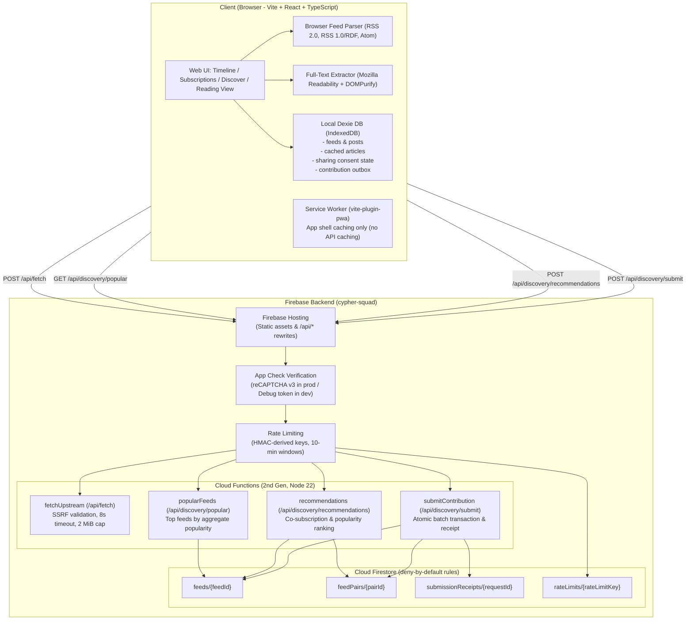

# Small Web Reader: Anonymous Discovery for Independent Blogs

A web-based, offline-first RSS/Atom reader that lets readers follow independent blogs, read full-text articles offline, and discover new blogs through anonymous recommendations based on aggregate co-subscription patterns.

---

## 1. Architecture Overview



### Server Routes & Contracts

| Route | Method | Function | Description |
| :--- | :--- | :--- | :--- |
| `/api/fetch` | POST / GET | `fetchUpstream` | Fetches raw feed XML or article HTML across CORS boundaries. Never stores, caches, or parses content on the server. Enforces SSRF blocks, redirect limits (max 3), 8s timeout, and 2 MiB response limits. |
| `/api/discovery/popular` | GET | `popularFeeds` | Returns top feeds sorted by seeded + live aggregate popularity. Does not accept subscription lists; does not increment counters. |
| `/api/discovery/recommendations` | POST | `recommendations` | Receives followed feed URLs (max 100) only when personalized discovery is explicitly enabled. Ranks candidate feeds combining co-subscription pair hits and popularity while strictly excluding already-followed feeds. |
| `/api/discovery/submit` | POST | `submitContribution` | Accepts an anonymous batch of 1–20 eligible feed URLs with a stable client-generated `requestId`. Executes a Firestore transaction to update feed popularity and pairwise co-subscription counters, storing an idempotency receipt. |

---

## 2. Setup & Deployment Instructions

### Option A: Vercel + Firestore Deployment
The app deploys both the frontend and `/api/*` serverless endpoints to Vercel. The Vercel endpoints use Firebase Admin SDK to persist discovery aggregates in Cloud Firestore.

Add these server-only environment variables to the Vercel project:

```text
FIREBASE_PROJECT_ID
FIREBASE_CLIENT_EMAIL
FIREBASE_PRIVATE_KEY
RATE_LIMIT_SECRET
```

`FIREBASE_PRIVATE_KEY` must be the service-account private key and must never be exposed as a `VITE_` variable or committed to the repository.

```bash
# Deploy from the local repository
npx vercel

# Production deployment
npx vercel --prod
```

The Firestore collections used by the Vercel API are `feeds`, `feedPairs`, and `contributionReceipts`. The API uses transactions and request receipts so repeated contribution requests do not double-count.

### Option B: Local Firebase Emulator Suite (100% Free for Local Testing & Evaluation)
For local testing and presentation, the Firebase Emulator Suite runs all services locally:
```bash
# 1. Install dependencies
npm install
cd functions && npm install && cd ..

# 2. Start emulators (Functions, Firestore, Hosting)
firebase emulators:start --only functions,firestore,hosting

# 3. Seed Firestore records
cd functions && npm run seed && cd ..

# 4. Start frontend
npm run dev
```

---

## 3. Privacy & Threat Model

### What the Server Stores
- **Deterministic Feed Aggregates** (`feeds/{feedId}`): SHA-256 hash of normalized URL, feed title, description, `seededPopularityCount`, and `livePopularityCount`.
- **Co-subscription Pair Aggregates** (`feedPairs/{pairId}`): Sorted feed IDs, `liveCoSubscriptionCount`, and `seededCoSubscriptionCount`.
- **Short-Lived Idempotency Receipts** (`submissionReceipts/{requestId}`): Random client-generated request ID and 7-day expiration timestamp to ensure network retries do not double-increment counters.
- **Short-Lived Rate Limit Keys** (`rateLimits/{key}`): Salted HMAC hash of `endpoint:IP:window` expiring every 10 minutes.

### What the Server NEVER Stores
- **No User Accounts or Persistent IDs**: No usernames, passwords, cookies, or device fingerprints.
- **No Browsing or Reading History**: `isViewed` state, open articles, and click streams stay strictly in the user's browser IndexedDB.
- **No Raw Feed XML or Article HTML**: All parsing, sanitization, and caching are executed client-side.
- **No Raw IP Addresses**: Client IP addresses are never logged or stored in plain text.
- **No Raw Subscription Profiles**: Submissions are anonymous one-time aggregate updates; individual reading profiles are never created or linked.

### How Opt-in Works
1. **Private by Default**: Followed feeds remain local on the device.
2. **Personalized Discovery Opt-In**:
   - Disabled by default. When disabled, only global popular feeds are requested (`GET /api/discovery/popular`). No subscription URLs leave the device.
   - When enabled, current followed feed URLs are transiently sent with recommendation requests (`POST /api/discovery/recommendations`) to score co-subscription relevance. The server does not persist this list.
3. **Explicit Batch Contribution**:
   - A separate action from viewing recommendations.
   - The user clicks **Contribute selected feeds**, opening a review modal showing the exact feeds being shared.
   - Confirms a one-time batch of 1–20 eligible feed URLs.
   - Stored in Dexie outbox with a random request ID. If offline, retries on reconnection; disabling personalized discovery clears unsent outbox items.

### Abuse Resistance
- **App Check**: Enforced across all endpoints. In production, requests without a verified reCAPTCHA v3 App Check token receive `401 Unauthorized`.
- **Endpoint Rate Limiting**:
  - `fetchUpstream`: 120 requests / 10 min
  - `popularFeeds`: 60 requests / 10 min
  - `recommendations`: 60 requests / 10 min
  - `submitContribution`: 12 requests / 10 min
  - Rate limit rejections return `429 Too Many Requests` with `Retry-After`.
- **SSRF Defense**:
  - Rejection of private IPv4 (10/8, 172.16/12, 192.168/16, 127/8, 169.254/16, CGNAT 100.64/10), loopback, link-local, multicast, reserved (0.0.0.0/8, 240/4), and IPv6 private/mapped equivalents.
  - DNS resolution validation before outbound requests.
  - Manual revalidation of all redirect hops (max 3).
  - 8-second request abort timeout.
  - 2 MiB response body cap.
  - Rejection of credential-bearing URLs and secret-like query parameters.

---

## 4. Demo Instructions & Edge Cases

### Sample Feeds to Try
- **Standard RSS**: `https://hnrss.org/frontpage`
- **Standard Atom**: `https://increment.com/feed.xml`
- **Autodiscovery (Blog URL)**: `https://blog.cloudflare.com` (discovers `/rss/`)
- **Large Publication**: `https://feeds.bbci.co.uk/news/rss.xml`

### Testing Edge Cases
1. **No Feed Found**: Enter `https://example.com`. The resolver tries HTML discovery and common feed paths (`/feed`, `/rss.xml`, `/atom.xml`), cleanly alerting that no feed was found.
2. **Dead / Unreachable Feed**: Enter a non-existent domain like `https://dead-feed-test-998877.example/feed.xml`. The app flags the feed status as `temporary-error` while keeping the timeline intact.
3. **Extraction Failure / Summary Fallback**: Disconnect your internet connection or use a site that blocks bots. In Reader view, the app falls back gracefully to the feed entry summary and provides a direct link to the original article.
4. **Duplicate URLs**: Attempting to add an already-followed feed is detected, and duplicate entries within contribution batches are deduplicated automatically before pair calculation.
